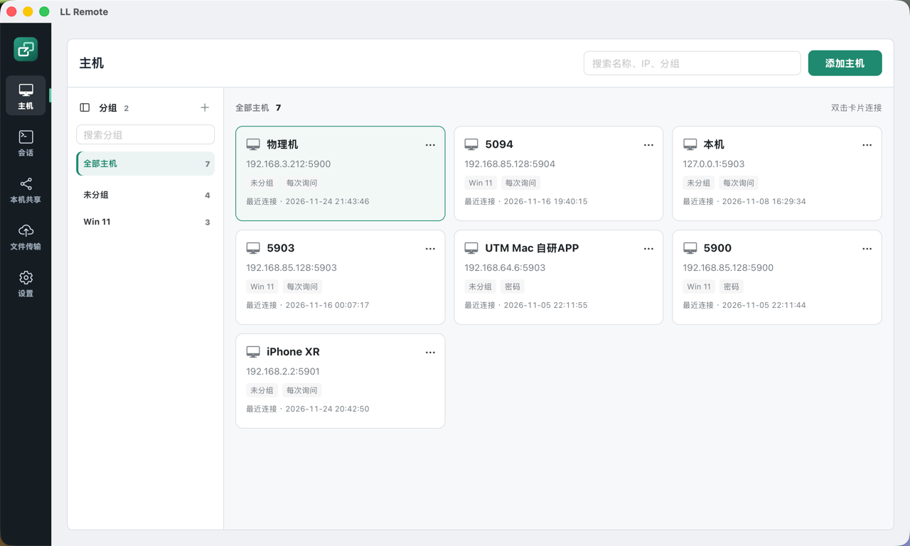

<div align="center">
  
  <h1>LL Remote</h1>
  <p><strong>内网远程连接与协助</strong></p>
  <p>主机管理 · 多会话 · 本机共享 · 文件上传 · 截图与无声录制</p>
  <p>
    <a href="#开发"></a>
    <a href="#开发"></a>
    <a href="#开发"></a>
    <a href="#平台与状态"></a>
    <a href="#许可证"></a>
  </p>
  <p>
    <a href="#主要功能">主要功能</a> ·
    <a href="#获取与上手">获取与上手</a> ·
    <a href="#开发">源码开发</a> ·
    <a href="#许可证">许可证</a>
  </p>
</div>

LL Remote 可以在内网连接另一台电脑，查看画面并用键盘和鼠标操作。你也可以打开“本机共享”，让另一台设备通过 VNC 连接这台电脑。

<p align="center">
  
</p>
<p align="center"><sub>应用界面示例：主机管理</sub></p>

## 主要功能

- 保存常用电脑的地址，按组整理、搜索并查看最近连接时间。
- 同时连接多台电脑，把会话放到独立窗口，按需缩放画面。
- 从“本机共享”开启或停止这台电脑的桌面共享。
- 截取远端画面、录制无声视频，也可以查看连接和权限问题。
- 远端支持时，可以同步剪贴板、上传文件和切换显示器。
- 选择保存密码后，密码由电脑的系统安全存储保管。

## 平台与状态

首发版本为 **1.0.0**。下载时请选与这台电脑的系统和处理器匹配的安装包。

| 平台 | 系统要求和安装包类型 |
| --- | --- |
| macOS | macOS 15 或更新版本，区分 Apple 芯片和 Intel 芯片。共享 Mac 屏幕需要屏幕录制权限，允许对方操作键鼠还需要辅助功能权限。 |
| Windows | Windows 10 1809 或更新版本，区分 x64、x86（32 位）和 ARM64。安装 Windows 系统共享服务需要管理员授权。 |

## 获取与上手

从首发发布页下载安装包，核对发布页上的 SHA-256 校验值后安装。安装范围、系统权限和卸载步骤见[安装说明](docs/distribution/INSTALL.md)。

### 连接远端

1. 在要连接的电脑上开启 VNC 共享，确认这台电脑能通过网络访问它。记下对方提供的地址和端口。
2. 在 LL Remote 的“主机”页面添加该地址和端口。连接需要密码时按提示输入，可自行选择是否保存。
3. 双击主机卡片，在“会话”里查看和操作远端桌面。

### 开启本机共享

1. 打开“本机共享”，填写共享地址、端口和访问密码。
2. 按页面提示完成必要的权限授权，点击“开始共享”。
3. 在另一台设备的 VNC 客户端中填写连接地址、端口和密码。

关闭 LL Remote 后，共享仍在后台运行。用完请回到“本机共享”点击“停止共享”。

## 使用边界

- 画面、键鼠、剪贴板和上传内容通过未加密的连接传输。请在可信内网或受控的加密通道中使用，避免将共享端口直接开放到互联网。
- 连接兼容的 VNC 服务即可查看画面和使用键鼠。剪贴板、上传和显示器切换取决于对方支持的功能。
- 文件目前只能上传到远端。视频录制只有画面，连接也不传输声音。
- 能否操作远端的锁屏、管理员授权界面和系统快捷键，取决于对方的系统、权限和共享方式。

## 开发

应用使用 Tauri 2、Vue 3、TypeScript 和 Rust。开发环境建议使用 Node.js 24+、pnpm 11 和 Rust stable，并先安装 [Tauri 2 平台依赖](https://v2.tauri.app/start/prerequisites/)。

- macOS：Xcode Command Line Tools。
- Windows：Microsoft C++ Build Tools、WebView2，以及 MSVC Rust 工具链。

前端测试使用 Node.js 的[原生 TypeScript 支持](https://nodejs.org/api/typescript.html)。

前端类型检查和生产构建在含中文、空格和 `%` 的目录中有真实 CLI 回归覆盖。请避免构建根路径中包含 `#`：当前 Vite 会将其作为 URL 后缀截断，已在 macOS 构建探针中复现；相关上游记录见 [Vite 路径问题](https://github.com/vitejs/vite/issues/11784)。此限制描述的是源码构建目录。

### 从源码运行

克隆或下载仓库后，在仓库根目录执行：

```bash
pnpm install
pnpm tauri dev
```

首次运行无需创建 `.env`。需要开发诊断或文件日志时，参考[环境变量示例](.example.env)。

### 构建桌面安装包

以下命令均从仓库根目录执行，需先完成 `pnpm install`，并使用 `rustup` 安装所需的 Rust target。按目标系统和 CPU 架构选择命令。

#### macOS：构建 `.dmg`

在 macOS 上执行，选择 Apple Silicon（M 系列芯片）或 Intel 版本：

```bash
# Apple Silicon / ARM64
rustup target add aarch64-apple-darwin
pnpm tauri build --target aarch64-apple-darwin --bundles dmg

# Intel / x64
rustup target add x86_64-apple-darwin
pnpm tauri build --target x86_64-apple-darwin --bundles dmg
```

`.dmg` 输出目录为 `src-tauri/target/<target>/release/bundle/dmg/`，其中 `<target>` 对应上方命令中的架构目标。

DMG 图标打包及共享后台权限排障见 [构建与打包排障](docs/distribution/BUILD-TROUBLESHOOTING.md#macos-dmg-图标和-zip)。

#### Windows：构建 NSIS `.exe` 安装包

在 Windows PowerShell 中执行。Visual Studio Installer 中需安装 C++ x86/x64 构建工具和 Windows SDK；构建 ARM64 时还需安装 **C++ ARM64 build tools**。

```powershell
# x86 / 32 位
rustup target add i686-pc-windows-msvc
pnpm installer:windows i686-pc-windows-msvc

# x64 / 64 位（Intel、AMD）
rustup target add x86_64-pc-windows-msvc
pnpm installer:windows x86_64-pc-windows-msvc

# ARM64 / 64 位 ARM 芯片
rustup target add aarch64-pc-windows-msvc
pnpm installer:windows aarch64-pc-windows-msvc
```

安装包输出到 `src-tauri/target/<target>/release/bundle/nsis/`，每个目标生成一个 `-setup.exe`。安装范围、预检和打包校验的实现见 [Windows 安装器](docs/distribution/WINDOWS-INSTALLER.md)。

更多打包说明见 Tauri 官方文档：[macOS DMG](https://v2.tauri.app/distribute/dmg/)、[Windows 安装包与架构选择](https://v2.tauri.app/distribute/windows-installer/#building-for-32-bit-or-arm)。

### 验证

在仓库根目录执行前端检查与测试：

```bash
pnpm repository:check
pnpm build
pnpm test
```

`pnpm repository:check` 检查当前跟踪文件，以及 HEAD、本地分支、远端跟踪分支和标签可达的历史。它拒绝内部资料、缓存和凭据文件，并扫描常见私钥与令牌格式。CI checkout 需要通过 `fetch-depth: 0` 获取完整历史。

`pnpm build` 检查构建配置和前端类型，再生成生产资源；桌面程序与安装包由 `pnpm tauri build` 构建。

Rust 检查与测试在 `src-tauri/` 下执行：

```bash
cd src-tauri
cargo check
cargo test
```

自动化检查不替代真实 VNC 连接、系统权限和桌面交互验证。

## 文档与反馈

- 可在“设置 → 关于”的“使用说明”中离线阅读[安装与使用说明](docs/distribution/INSTALL.md)和[数据与隐私](docs/distribution/PRIVACY.md)。[1.0.0 发行说明](docs/distribution/RELEASE-NOTES.md)和许可文件也随安装包提供。
- [第三方许可与声明](licenses/THIRD-PARTY-NOTICES.txt)、[许可来源与更新方法](licenses/README.md)。更新依赖后执行 `pnpm licenses:generate`，构建前执行 `pnpm licenses:check`。
- [CI 和候选包校验](docs/distribution/CI.md)
- [架构与数据流](Architecture.md)
- 模块说明：[主机](src/hosts/README.md)、[会话](src/session/README.md)、[本机共享](src/server/README.md)、[Rust 后端](src-tauri/src/README.md)
- [Server Discovery 扩展协议](docs/design/server-discovery-protocol.md)
- [WebView 内容来源约束与验证边界](docs/design/webview-csp.md)

欢迎通过本仓库的 Issues 反馈问题或提交 Pull Request。问题中请附操作系统、应用版本和复现步骤；附带日志前请检查并移除敏感信息。

## 许可证

本项目采用 **MIT License**，允许商业使用、修改和分发；使用时须保留版权声明和许可声明。完整条款见 [LICENSE](LICENSE)。第三方组件仍遵循各自的许可证。
